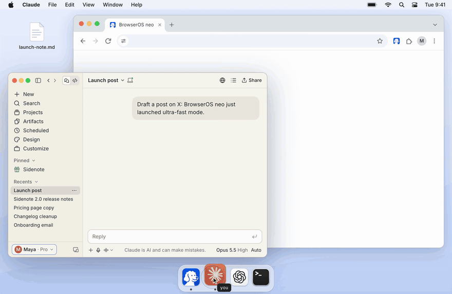
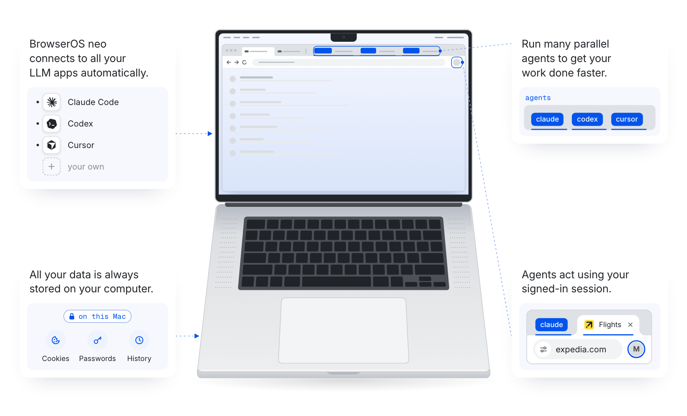

<!-- Two images, not <picture>: GitHub's own CSS hides the one that does not match its theme (the #gh-…-mode-only suffix).
     A <picture> follows the computer's theme whenever GitHub's script has not rewritten it, and showed the dark banner on a light page.
     Keep both images out of a link, or the suffix no longer ends the link GitHub wraps around each one. -->
<p align="center">


</p>

<p align="center">
Claude Code, Codex and Cursor work in it <strong>signed in as you, in their own tabs, while you watch.</strong><br>Free, open source, and it runs on your machine.
</p>

<p align="center">
<a href="https://github.com/browseros-ai/BrowserOS"></a>
<a href="LICENSE"></a>
<a href="https://discord.gg/YKwjt5vuKr"></a>
<a href="https://x.com/browserOS_ai"></a>
<a href="https://docs.browseros.com"></a>
</p>

<p align="center">
<a href="https://cdn.browseros.com/download/BrowserOS_neo.dmg"></a>
<a href="https://cdn.browseros.com/download/BrowserOS_neo_installer.exe"></a>
<a href="https://cdn.browseros.com/download/BrowserOS_neo.AppImage"></a>
<a href="https://cdn.browseros.com/download/BrowserOS_neo.deb"></a>
</p>

<p align="center">

</p>

## Quick start

1. **Install.** Use a button above, or Homebrew:

   ```sh
   brew tap browseros-ai/tap
   brew install --cask browseros-neo
   ```

2. **Import from Chrome.** One click brings your logins, bookmarks and extensions.
3. **Connect your agent.** neo finds Claude Code, Codex, Cursor, VS Code and more on your machine. One click each.
4. **Give it a task.** From your agent, not from the browser:

   > Book me the cheapest flight to London.


## What you get

- **Signed in as you.** Agents work in your real accounts, not a blank sandbox.
- **Their own tabs.** Every agent gets its own tab group. Run many at once. Your tabs stay yours.
- **You can watch.** Follow each step live, or replay any session later.
- **Hand-off.** Stuck at a login? neo notifies you, you help, the agent carries on.
- **Fewer tokens.** neo reads a page as short text, not as screenshots.
- **Local.** Sessions, screenshots and history stay on your machine. [Privacy](https://docs.browseros.com/neo/privacy)

<p align="center">

</p>

## What agents do with it

- **Sales.** Select leads in Salesforce and copy them into your outreach sheet.
- **Coding.** Deploy a function on AWS and check that the update went live.
- **Research.** Compare Reddit and X posts and save the sources behind your answer.
- **Finance.** Check bills in Brex against purchase orders and flag extra charges.

## Benchmarks

About **63% faster** and **40% fewer tokens** than the browsers built into Claude and ChatGPT, and it finishes about **96%** of tasks. These figures are approximate, and the full benchmark write-up is not published yet.

| Tool | Time per task | Tokens per task | Tasks finished |
| :-- | --: | --: | --: |
| **BrowserOS neo** | **~102 s** | **~21.6k** | **~96%** |
| Claude’s built-in browser | ~264 s | ~35.4k | n/a |
| ChatGPT’s built-in browser | ~276 s | ~35.8k | n/a |
| `chrome-devtools-mcp` | ~192 s | ~29.4k | ~84% |
| `playwright-mcp` | ~214 s | ~31.2k | ~76% |

## Why not something else?

| Instead of | The catch | With neo |
| :-- | :-- | :-- |
| **Headless drivers**<br>Playwright MCP, agent-browser | A fresh Chrome with no logins. Fine for CI, not for your inbox. | Your logins, imported from Chrome in one click. |
| **Cloud browsers**<br>Browserbase, browser-use | Datacenter IPs get blocked, and signing in is a chore. | Runs on your machine, at `127.0.0.1`. |
| **AI browsers**<br>Atlas, Comet, Dia | Each works only with its own AI. | Works with the agent you already pay for. |

## FAQ

<details>
<summary><strong>Which agents work with neo?</strong></summary>

Any agent that speaks MCP. Claude Code, Codex, Cursor, OpenCode, Antigravity, VS Code and Zed connect in one click. Claude Desktop takes a one-file extension, and anything else connects with the endpoint URL. [Setup guide](https://docs.browseros.com/neo/mcp).
</details>

<details>
<summary><strong>Can I keep using my browser while agents work?</strong></summary>

Yes. Agents work in their own tab group. Your tabs stay yours.
</details>

<details>
<summary><strong>Does anything leave my machine?</strong></summary>

Sessions, screenshots and history stay on your disk. neo sends anonymous usage events (never URLs, page content or prompts); one toggle in Settings turns them off. [Full policy](https://docs.browseros.com/neo/privacy).
</details>

<details>
<summary><strong>Do my Chrome extensions and bookmarks work?</strong></summary>

Yes. neo is a Chromium fork, so extensions work, and bookmarks, passwords and settings import in one click.
</details>

## Community and contributing

[Website](https://www.browseros.com) · [Docs](https://docs.browseros.com) · [Discord](https://discord.gg/YKwjt5vuKr) · [Slack](https://dub.sh/browserOS-slack) · [X](https://x.com/browserOS_ai) · [Report a bug](https://github.com/browseros-ai/BrowserOS/issues) · [Enterprise](mailto:founders@browseros.com?subject=Enterprise%3A%20BrowserOS%20neo)

We would love your help. The [Contributing guide](CONTRIBUTING.md) routes you: the neo app (TypeScript, React, Rust) sets up in about 15 minutes; the browser (C++, Python) needs about 100 GB of disk.

> [!TIP]
> **Support open-source agent browsing.** [Star the repo](https://github.com/browseros-ai/BrowserOS) and watch releases to hear when agents can do something new.
>
> [](https://github.com/browseros-ai/BrowserOS)

Credits: [Chromium](https://www.chromium.org/) and [ungoogled-chromium](https://github.com/ungoogled-software/ungoogled-chromium) · [AGPL-3.0](LICENSE) · © 2026 Felafax, Inc.

## Stargazers

Thank you to all our supporters.

<table>
<tr>
<td align="center">Nikhil</td>
<td align="center">Nithin</td>
<td align="center">Dani</td>
</tr>
<tr>
<td align="center"><a href="https://x.com/intent/user?screen_name=nv_sonti"></a></td>
<td align="center"><a href="https://x.com/intent/user?screen_name=ThatNithin"></a></td>
<td align="center"><a href="https://x.com/intent/user?screen_name=dani_akash_"></a></td>
</tr>
</table>

<p align="center">
Built with ❤️ from San Francisco
</p>
