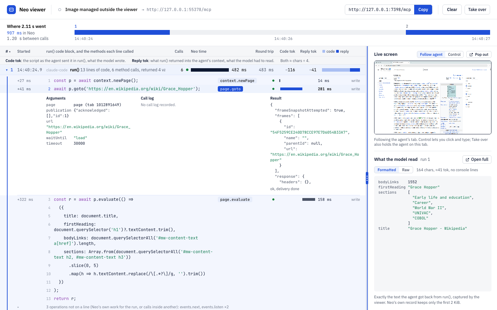

# Neo viewer

A local tool for one person: start it, give an agent its one MCP URL, and watch every `run()` call
the agent makes against the Neo SDK image: the code it sent, the methods each line called, what the
model read back, how long each took and roughly how many tokens, and Neo's screen live. It is a dev
tool under `tools/`: not shipped, and not part of the image.



```text
 agent ──MCP──▶ viewer (Bun, 127.0.0.1:7310/mcp) ──MCP──▶ Neo SDK image (127.0.0.1:<port>/mcp)
                  │ records every call and reply,       ▲
                  │ as sent and as received             │ host API: run records, live screen, takeovers
                  ▼                                     │
               log.jsonl in the state folder ──▶ /api/* ──▶ the page at /
```

## Start it

From `packages/browseros-agent`:

```sh
bun run neo:viewer
```

That is the whole loop. It works out this checkout's Neo SDK image the way `build.sh` names it
(`neo-sdk:<browser>-<commit>[-dirty]-<arch>`), builds it with `build.sh` when it is not on the
machine or the checkout's uncommitted build inputs changed since the viewer built it, starts it
fresh, and prints:

```text
  Viewer:         http://127.0.0.1:7310
  Agent MCP URL:  http://127.0.0.1:7310/mcp
  Claude Code:    claude mcp add --transport http neo-viewer http://127.0.0.1:7310/mcp
```

Open the Viewer URL. Give every agent the same MCP URL: there is one, and every agent's runs go
into one list. A first build takes about 7 minutes; a new commit that leaves the server alone
rebuilds from Docker's cache in seconds, and uncommitted changes outside the image's build inputs
(this tool, say) reuse the commit's image.

Ctrl-C stops the viewer and removes the container and network it started. Each start begins
clean: it removes what the previous start of the same instance left (the container, network and
data) and, after a new build, the image the previous build made.

| Flag | |
|---|---|
| `--name <instance>` | which viewer this is (default `default`); see Instances |
| `--keep-data` | keep the browser profile (logins) and the run list between starts |
| `--no-build` | use the newest `neo-sdk` image already on this machine |
| `--image <tag>` | use this image; nothing is built |
| `--upstream <url>` | forward to a Neo MCP endpoint you started yourself; no container |
| `--host-token-file <file>`, `--host-api <url>` | with `--upstream`: that Neo's host API (`CLAW_HOST_TCP`, default `http://127.0.0.1:9300`), for run records and the live screen |
| `--port <port>` | the viewer's port (7310) |
| `--data-dir <dir>` | the viewer's state folder (see The log) |

Pass flags after `--`: `bun run neo:viewer -- --keep-data`. The same settings come from
`NEO_VIEWER_INSTANCE`, `NEO_VIEWER_PORT`, `NEO_VIEWER_UPSTREAM` and `NEO_VIEWER_DATA_DIR`. The
viewer listens on 127.0.0.1 only, and publishes the image's ports on 127.0.0.1 only.

### When it stops at the packages

Before any Docker work it checks this tool's packages against its `package.json` and `bun.lock`
(missing, or not the lockfile's version after a pull) and builds the page, so a bad install fails
in a second. When something is missing it installs it with the Bun that is running (`bun install
--frozen-lockfile`, so `bun.lock` is never rewritten), says so in one line, looks again and
carries on:

```text
Installing the viewer's packages with Bun 1.4.4 (acorn missing): bun install --frozen-lockfile in …/packages/browseros-agent
```

Any Bun from 1.2.19 does this (`MIN_INSTALL_BUN` in `server/dependencies.ts` says what was
proved). An older Bun, or an install that still left something missing, stops with one line naming
the Bun needed and the command to run:

```text
neo-viewer: its packages are missing or older than bun.lock (acorn missing), and Bun 1.2.18 cannot install them: it needs Bun 1.2.19 or newer. Run: cd …/packages/browseros-agent && npx -y bun@1.4.2 install --frozen-lockfile
```

### Instances

Every start belongs to one instance, `--name <instance>` (or `NEO_VIEWER_INSTANCE`, default
`default`): the container `neo-viewer-<instance>`, the network `neo-viewer-<instance>-net`, the
volume `neo-viewer-<instance>-data` and the state folder `~/.local/state/neo-viewer/<instance>`.
A start replaces only an earlier start of the same instance; if that one's viewer is still running
it says so in one line, and refuses (touching nothing) when that viewer holds the same port.
Cleanup never touches another instance: each object carries the labels `com.browseros.neo-viewer`
and `com.browseros.neo-viewer.instance`, a same-named object without them stops the start, and the
only images removed are ones this instance's own builds replaced (recorded in its `start-state.json`).
Instances on one commit share one image, so even that waits while anything else holds it: any
container, running or stopped, or another instance's `start-state.json` naming it as its last build.
The start says in one line what it kept and why, and tries again at its later starts; it never
forces a removal (Docker refuses a plain one under a container, and a forced one deletes the image
under a stopped container).
**Workers and scripts: always pass your own `--name` and port; `default` is the owner's.**

### The container

It is started as [the image's README](../../crates/neo-sdk/neo-server/docker/README.md) shows for
a standalone start: its own Docker network, `NEO_MCP_REMOTE=true`, and the host API over the
development option `CLAW_HOST_TCP` with a token file the command writes (mode 0600) in the state
folder; both ports are published on 127.0.0.1 at ports Docker picks. Inside the container
`CLAW_HOST_TCP` binds `0.0.0.0:9300`: bound to `127.0.0.1` the published port answers nothing,
since Docker's port forward arrives from outside the container's loopback. When Docker's address
pools are used up it names a /24 itself and says so. The command is the only control: the page
shows the image and whether the container is up, read-only.

## The screen

The page at `/` (the approved design, "Viewer C v2"):

- **Top bar.** Whether the container is running and its image tag (read-only; with `--upstream`
  it says the image is managed outside the viewer and where MCP goes), the MCP URL with **Copy**,
  **Clear**, **Export** (below), and **Take over** (below).
- **Where the time went.** The wall clock since the last Clear, from the first call to the last
  reply (to now while a run is running): each run sits where it happened, its time in Neo in blue
  (red if it failed, amber while running) after a grey sliver for the time the viewer held the call.
  On the left, the total in Neo against the time between calls (the model thinking, the agent's
  other tools, any human wait).
- **The runs.** One row per `run()` call, in order: when it started, the client that sent it,
  its first statement, how many calls Neo recorded, Neo time with a bar, the round trip the
  agent waited, **Code tok** (the script as sent, what the model wrote) and **Reply tok** (what came back,
  what the model read) with a stacked bar, and a totals row. Every bar is a share of its column's
  largest value. Click #, Neo time, Round trip, Code tok or Reply tok to sort by it (again to
  flip). Tokens are estimates, characters ÷ 4, always shown with "≈".
- **An open run.** Click a row: its script laid out one statement per line, indented by depth,
  with the line numbers counting those lines. Agents send code minified on one line; only the
  whitespace between tokens changes (`shared/code-format.ts`, driven by acorn's parse), so every
  token is as sent, a line still wider than 80 columns breaks at an object, a method chain or an
  argument list, and code that does not parse is shown as sent. On each line, the methods that
  line called, from Neo's record of the run: start offset, the name Neo recorded (it
  can differ from what the script wrote: `page.textContent('h1')` is `locator.textContent`), the
  outcome, a bar for when it ran within the run's own time, its duration, and read or write. A line
  that called many (a loop) folds the rest behind one row. Click a method for its arguments (a
  locator by its text, the timeout, the name the script used when it differs), call log, result,
  outcome and error; Neo keeps arguments up to 4 KiB and results up to 2 KiB, and the panel says so
  when it cut one. Neo's own work for the run (opening the page, listening for events) folds into
  one quiet row under the code. Under it, **Model read**: the reply in one line, its size, and
  **Open full**. A run still running, or one without Neo's record, shows its code alone.
- **What the model read.** The sidebar's lower half: the selected run's whole reply, exactly as
  the agent got it, formatted (keys aligned, a snapshot line by line) or raw. Until you click a
  row it follows the newest run. Drag the handle between the runs and the sidebar to resize it.
- **Open full.** The reply in a large pop-up with line numbers, find (Enter and Shift+Enter step
  through the matches), copy, and previous / next output. Escape closes it.
- **The live screen.** The sidebar's upper half: Neo's screen, live. **Follow agent** watches the
  tab the agent's latest run used and moves with it; **Control** lets you click and type (the agent
  is not held). Docked, it is as wide as the sidebar (drag the handle to make it bigger) and keeps
  Neo's screen ratio. **Pop out** opens it large over the page; closing it docks it back. **Take over**
  (top bar, or in the pop-up) gives you the agent's tab: its calls on that tab fail with
  `owner_has_control` until you press **Give back**, or until the takeover expires (Neo's default,
  20 minutes).

`/?plain` is a plain list of the same runs (code, reply, raw request and reply, the live screen
beside it), kept for debugging.

## What the proxy changes

Nothing, in either direction. Every method, path, header and body reaches Neo as the agent sent it,
and every reply reaches the agent as Neo sent it, byte for byte, chunk by chunk as it streams; so
Neo behaves exactly as it does without the viewer: a run that names no task gets a new tab of its
own (plain Playwright), a script picks a task with `neo.createTask`/`neo.task(id)`, and a request's
`_meta["com.browseros.neo/run"].taskId` (a host's task; zuzu sends one) keeps that task's tab (#3452).
That `_meta` taskId passes through untouched and the run shows it beside the client
(`RunSummary.agentTaskId`). The tasks a run touched come back in the reply's
`_meta["com.browseros.neo/run"].tasks`; the viewer reads them into `RunSummary.tasks`. Headers that belong to one HTTP hop (`connection`,
`transfer-encoding`, `content-length`, `host`) are set by each hop, as for any proxy. When the agent
goes away mid-reply the viewer closes its request to Neo, which is how Neo's stateless MCP learns to
stop the run.

## One list

Every call through the proxy is appended to one list, in the order it reached the viewer, whichever
agent sent it (owner, 2026-11-11: an agent that calls the MCP URL from a new curl or Python process
each time is still one job). Each run shows its client as a quiet label: its `clientInfo`, an older
client's `initialize`, or its User-Agent's product name, since several agents may share the list.
The tasks a run touched show beside it as quiet chips, one hue per task so a task's runs stand out
down the list: the ones its script created or picked (`neo.createTask`, `neo.task`, from the
reply's `_meta`), and the host's task (the request's `_meta["com.browseros.neo/run"].taskId`, which
picks the run's tab) marked "host". A closed row shows the first and "+N"; open, all of them. No
menu or filter: one list on purpose. A `taskId` tool argument is refused by Neo (`unknown field taskId`).
**Clear** (top bar, or `POST /api/clear`) empties it; the log before it is kept once, as
`log.prev.jsonl`, in case of a mis-click. Clear leaves Neo's tabs as they are: each run that names
no task leaves a tab, which Neo closes after 30 minutes idle. Stopping the viewer removes them only
with the container it started; with `--upstream` it started none, and Neo keeps its tabs.

## The log

On disk: one append-only JSONL file, `log.jsonl`, in the instance's state folder
(`--data-dir`, else `$NEO_VIEWER_DATA_DIR`, else `$XDG_STATE_HOME/neo-viewer/<instance>`, else
`~/.local/state/neo-viewer/<instance>`), beside `log.prev.jsonl` (the list before the last Clear),
the host token and `start-state.json`. The first
line starts the log; then one line per thing as it happened (`run-start` with the request body as
sent, `run-end` with the reply body as received, its text, structured content and `_meta`,
`neo-run` with Neo's record of the run, `tools-list` with the tool list a client read and its size).
A restart reads the file back, so nothing written is lost; a run that had started but not ended
when the viewer stopped shows as `lost`. Each start of `bun run neo:viewer` begins with an empty
log, as it does with a fresh browser profile, unless given `--keep-data` (or `--upstream`, which
starts no container). Tokens are estimates, characters divided by four, always shown with "≈".

## Export

**Export** (top bar, or `POST /api/export`) writes every run since the last Clear to a new folder
for an agent to read, and shows its path with Copy path until dismissed; the terminal prints it too:

```text
/tmp/neo-viewer/<instance>/export-<YYYYMMDD-HHMMSS>/
  README.md            start here: what this is, totals, one row per run, how to read the rest
  session.json         the same facts as data, each run's file paths; no code or replies inline
  runs/NNN.md          one run top to bottom (shared/run-markdown.ts): code as the page lays it
                       out, each line's methods, every operation, the reply's first 2,000 chars
  runs/NNN.json        that run complete: request and reply as they crossed, Neo's record
  runs/NNN.reply.txt   the text the model read, alone (.reply.json when it is JSON)
  log.jsonl            the raw log
```

It lives outside the state folder, so it survives the viewer stopping and Clear. An agent can start
at one small file and open only what a question needs: README.md stays under about 300 lines however
many runs there are. No host token or Authorization header is ever in an export. Screenshots are
not exported.

**Copy** on a run row (at its right end: on hover, on keyboard focus, always on an open row) puts that
run's Markdown on the clipboard, from the same renderer as `runs/NNN.md` but with the whole reply:
paste it into any agent and ask about the run. A closed row's run is fetched at the click.

A returned string, such as a snapshot, reaches the model as one line of JSON (`\n`, `\"`). The plain
page, Copy and `runs/NNN.md` show it decoded, as lines, saying so and giving the JSON string's length;
the sizes and token counts stay those of what the model received, and the exact text stays in the
Raw view, `runs/NNN.json` and the reply file.

## The API

`shared/api.ts` holds the routes and their types; the server owns them and the page imports them.

| Route | Answer |
|---|---|
| `GET /api/info` | `ViewerInfo`: the MCP URL, the upstream, the data folder, and the container the command started (`container: {name, image, up}`, null with `--upstream`) |
| `GET /api/runs` | `RunsResponse`: every `RunSummary` since the last Clear, in order, and the log's totals (`LogSummary`) |
| `GET /api/runs/:runId` | `RunResponse`: one `RunDetail`, request and reply as they crossed |
| `POST /api/clear` | `RunsResponse`, empty: starts a new log, keeps the previous as `log.prev.jsonl`; only from the viewer's own page |
| `POST /api/export` | `ExportResponse` (`dir`, `files`, `runs`): writes the folder above; only from the viewer's own page |
| `GET /api/events` | SSE: one `ViewerEvent` per change: `{type:'run'}`, `{type:'log'}` (totals), `{type:'clear'}` |

Once a run's reply is in, the viewer reads Neo's record of it through the host API
(`GET /v1/runs/{id}?wait=10`, joined by the reply's `_meta["com.browseros.neo/run"].id`, which is
`RunSummary.neoRunId`) and keeps it in the log. `RunDetail.neo` holds it: the run's status,
Neo time and error, and each operation's name, kind, effect, script site `{line, column}`, start
offset, duration, args, result, notes, delivery and error (`NeoRunRecord`, `NeoOperation` in
`shared/api.ts`). `RunSummary` gains `neoDurationMs` and `operationCount`. Neo bounds stored args
(4 KiB) and results (2 KiB); the full reply the model read is the proxy's `reply.text`.

## Neo's host API

`server/hostApi.ts` is the viewer's one client for Neo's host API (`/v1`: runs, operations, tabs,
the display, takeovers). `bun run neo:viewer` configures it with the container it starts; with
`--upstream`, pass `--host-token-file` (and `--host-api`, default `http://127.0.0.1:9300`).

- `hostFetch(path, init)`: a request on the host API, bearer token added; Neo's `Response` comes
  back for `.json()` or `.arrayBuffer()`. With no host API the viewer answers in Neo's error shape:
  `503 no_host_api`, or `502 host_api_unreachable` when nothing answers.
- `hostWebSocketTarget(path)`: `{ url, headers }` for an upgrade route such as
  `/v1/display?mode=view`, opened server-side with `new WebSocket(url, { headers })`. Neo accepts
  the token only as a header, so it never goes in a URL and never reaches the browser.

## How the live screen works

The same panel docks in the designed screen's sidebar and sits beside the plain list. The browser
cannot reach Neo's host API (a bearer token, which a browser cannot put on a WebSocket), so the viewer
relays it and adds the token on its side; `shared/live-screen.ts` holds the routes and types.

```text
 page (noVNC) ──ws /api/live/display?mode=…──▶ viewer ──ws /v1/display?mode=… + token──▶ Neo
 page ──/api/live/status, /api/live/takeovers──▶ viewer ──/v1/tabs, /v1/trace, /v1/takeovers──▶ Neo
```

| On the panel | What it opens on Neo |
|---|---|
| Follow agent | `GET /v1/display?mode=view&followTab=<tab>`: watch; Neo keeps the agent's tab in front, the tab of the most recent run's last operation (from `/v1/trace`; subscriptions act on no tab, `newPage` counts with its new tab). When that run's request named a host task (`_meta…taskId`, see One list), `followTask=<task>` instead, so Neo follows it to a new tab by itself; a task a script picks with `neo.task` is not in Neo's trace, so such a run is followed by its tab; by tab, the panel moves when its status poll (1.5 s) sees the agent on another tab |
| Control | `GET /v1/display?mode=control`: clicks and keys reach the browser; the front tab stops following; the agent is not held |
| Take over / Give back | `POST /v1/takeovers {tabId, viewer}` for the agent's tab as the panel shows it, then `display?mode=control&release=<id>`; the agent's calls on that tab fail with `owner_has_control` until `POST /v1/takeovers/{id}/release`, or until the takeover expires (the viewer asks for no TTL, so Neo's default of 20 minutes applies). `viewer` is Neo's own screen size, so Neo's fit brings the tab to the front and leaves the screen as it is; Neo puts the window back on release |

The relay passes RFB frames and close codes through unchanged (Neo's `4002 released` ends a
takeover's display) and closes with its own codes for what Neo cannot say: 4901 the host API is not
reachable (no container), 4902 Neo refused the display (the reason carries Neo's error), 4903 the
connection dropped. The panel says so and reopens the display on its own, so it comes back when the
container restarts. The display and both POSTs take only requests whose `Origin` is the viewer's own
page: a WebSocket is not covered by the same-origin policy. The viewer gives back the takeovers it
holds when it stops.

Docked, the screen is as wide as the sidebar and as tall as Neo's screen ratio makes it (the
framebuffer size its RFB server reports; 1600×1000 until then), so dragging the sidebar wider zooms
in, live while dragging. It is never taller than the sidebar's visible height less the panel's
header row; only then does the picture letterbox. "What the model read" sits below it and the
sidebar scrolls (`web/live-screen/screen-fit.ts`).

The components are self-contained (`web/live-screen/`): `useLiveScreen()` makes the controller, and
`<LiveScreen size="docked" | "large">`, `<LiveScreenPopup>` and `<TakeOverButton>` take it. A page
makes one controller so the docked panel, the pop-up and Take over agree.

Neo's VNC server (TigerVNC's Xvnc) blocks a client address for 10 s, then twice as long each time,
after five connections that end before their handshake finishes, and every display reaches it from
Neo's own 127.0.0.1. So the panel opens a display only after it has stayed on screen for 150 ms; a
script that opens displays and drops them mid-handshake can still block every display for a while.

## Layout and checks

- `server/`: the Bun server. `main.ts` and `launch.ts` are the one command (`config.ts` its flags,
  `dependencies.ts` the package check, `neo-container.ts` Docker); `proxy/` forwards and reads MCP,
  `log/` the JSONL log and the in-memory store, `neo-runs.ts` joins Neo's run records, `hostApi.ts`
  is the host API client, `export/` writes an export, `api/` the routes, `live-screen/` the display
  relay and takeover routes.
- `web/`: the page, React and Tailwind as in `apps/claw-app`: `web/screen/` the designed screen,
  `web/App.tsx` the plain list, `web/live-screen/` the live-screen panel. `server/page.ts` bundles it
  in memory when the viewer starts (`Bun.build`, about 40 ms), compiling Tailwind with the same
  `@tailwindcss/node` and `oxide` packages claw-app's Vite plugin uses.
- `shared/api.ts`: the API's types; `shared/live-screen.ts`: the live screen's;
  `shared/code-format.ts` (with `code-gaps.ts`, `code-tree.ts`): a script laid out by statement,
  whitespace only, with sites mapped to display lines; `shared/run-markdown.ts`: one run as Markdown,
  for an export's `runs/NNN.md` and a run row's Copy.

```sh
bun run test                     # in this folder: unit tests, the proxy and the relay against a fake Neo, the screen
NEO_VIEWER_REAL_UPSTREAM=http://127.0.0.1:9010/mcp bun run test:real-image
# and the live screen, with the host API on TCP (CLAW_HOST_TCP=0.0.0.0:9300, port published on 127.0.0.1):
NEO_VIEWER_REAL_UPSTREAM=… NEO_VIEWER_REAL_HOST=http://127.0.0.1:9300 \
  NEO_VIEWER_REAL_HOST_TOKEN_FILE=<token file> bun run test:real-image
```

The live-screen real-image test speaks RFB through the relay without a browser: it follows the agent,
clicks and types in control mode, takes over (the agent's run fails with `owner_has_control`) and
gives back (Neo closes the owner's display with 4002).

The proxy's real-image test puts a TCP tap between the viewer and the image and checks that each reply the
agent read is the bytes Neo sent, for a plain value, an error, console lines, a blob marker and a
streamed reply. Neo streams its 5 s keep-alive only to 2025-06-18 clients: a 2026-07-28 reply is one
event at the end, however long the run takes.
